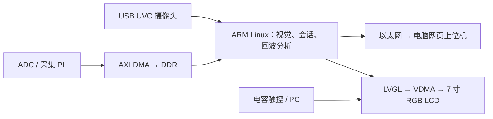

# Zynq 超声探伤与视觉定位工作站

面向 Zynq-7020 的超声检测辅助项目：视觉定位、人工网格扫描、回波分析，以及电脑网页与 800×480 LVGL 小屏显示。

> **首版开发源码（v0.1）：自主应用、UI、RTL 与参考配置按 MIT 开放。这不是已经完成真实探伤与运动闭环的成品，也不含可直接烧写的完整工程。**

## 系统结构



原型工件顶面 80×80 mm、厚度 30 mm；这些只是默认参数，并非视觉自动量尺结果。

## 功能与真实边界

| 模块 | 当前能力 | 尚待完成 |
| --- | --- | --- |
| 视觉定位 | 四角平面标定、红色标记定位、来源标注与图片导出；ARM 有标准库简化通路 | 固定机架后的精度、光照和视差实测 |
| 手动扫描 | 人工确认位置、网格采样、幂等提交、二维分布与剖面 | 真实回波源与工件标定 |
| 回波分析 | CSV 导入、包络、门区、峰值与标定参数 | 有孔/完整块对照实测及阈值 |
| 双端 UI | 电脑网页、LVGL 小屏、同会话传输、轻量三维反射点 | 现场触控稳定性及完整交互验收 |
| Linux 原型 | 已有 ARM Linux 启动、认证 API、UVC 取流和 DMA ramp TEST 证据 | SD 持久化、最终 Flash/冷启动验收 |
| 单轴运动 | 扫描计划、位置确认、适配器接口 | 驱动协议、限位、急停、位置闭环 |

DEMO 是合成数据；RECORDED 是导入记录；LIVE 必须来自实际采集源。DMA ramp 只验证传输，不是真实超声。三维图是反射位置指示，不是孔形、孔径或孔高重建。未扫描区域始终未知。

## 不接硬件体验

需要 Python 3.10 或以上。在 `firmware/inspection` 下执行：

```bash
python -m venv .venv
# Windows: .venv\Scripts\activate
# Linux: source .venv/bin/activate
python -m pip install -r requirements.txt
python -m utinspect map-demo --out runs/quickstart-demo
python -m utinspect manual-map --mode DEMO --out runs/manual-demo
```

最后一个命令在终端打印本机网页入口。手动打开浏览器；这里的 DEMO 不接相机，不控制高压或电机。参数以 `python -m utinspect --help` 及各子命令的 `--help` 为准。

USB 相机本机调试：

```bash
python -m utinspect workpiece --camera 0 --preview
```

首次安装依赖需要联网。相机索引按现场设备调整；平面标定、探头标记与人工到位确认不能省略。

## 测试

在 `firmware/inspection` 下执行：

```bash
python -m unittest discover -s tests -v
```

这里保留便携业务测试；依赖私有交付镜像、原机下载环境或平台发布脚本的测试不属于本次源码，排除清单见 `SOURCE_MANIFEST.json`。测试通过不等于实板或测量精度验收。

## LVGL 与硬件源码

- `firmware/lvgl_ui`：自主 UI、触控解析与过滤、Linux/桌面/裸机端口。依赖 LVGL 9.4.0；`python tools/setup.py` 按固定哈希获取，不打包整个 vendor。
- Windows 桌面 UI 需要 PATH 中的 MinGW `gcc`/`ar`，随后在该目录执行 `python tools/build_desktop.py`。
- `Makefile.linux` 是原生 Linux 构建入口；交叉编译时由 SDK 提供 `CC`/`AR`。端口依赖板卡专用驱动，并非普通电脑即插即用界面。
- `fpga`：安全触控平台的自定义 RTL、约束与测试源。缺少重建完整 BD 所需的已审平台快照，**不能将这些源文件当成可直接烧写工程**。
- `petalinux/linux`、`petalinux/recipes`：内核/设备树配置和 recipe 参考。不分发厂商内核/IP、SDK、BSP、XSA、镜像、凭证或本机 JTAG 下载脚本。
- 专用内核驱动和 `ut-platform` recipe 因许可标注需单独核对，本次未公开。LVGL recipe 对该驱动仍有依赖，不能直接从这里完整构建板端 Linux。

## 安全与许可

先读 [SAFETY.md](SAFETY.md)、[THIRD_PARTY_NOTICES.md](THIRD_PARTY_NOTICES.md) 和 [PUBLICATION_CHECKLIST.md](PUBLICATION_CHECKLIST.md)。当前安全 PL 将 OE/INA 固定为 0；没有真实发射或运动控制 ABI。不要绕过这些边界，也不要自动恢复来源未审查的旧固件。

自主代码采用根目录 [LICENSE](LICENSE) 的 MIT 许可；LVGL、字体等第三方内容保留各自许可。未提供启动镜像、私人照片、参赛签名材料、设备身份或口令。
