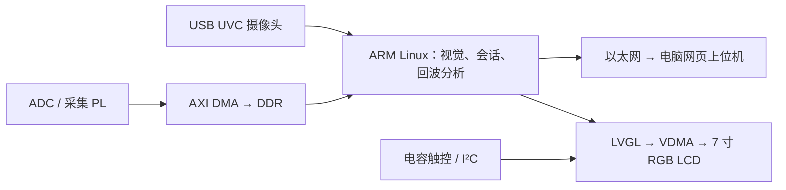

# Zynq 超声探伤与视觉定位工作站

面向 Zynq-7020 的超声检测辅助项目：视觉定位、人工网格扫描、回波分析，以及电脑网页与 800×480 LVGL 小屏显示。

> **开发源码（2026-11-02 更新）：自主应用、UI、RTL 与参考配置按 MIT 开放。这不是已经完成真实探伤与运动闭环验收的成品，也不含可直接烧写的完整工程。**

### 2026-11-02 波形判读更新

新增后段静区搜索、正常参考包络对比和显式质量原因；LIVE 默认缺陷门上限为 8.4 µs。未批准标定时只显示独立标记的参考深度，正式深度仍需标定。参考配置校验增益、采样周期和触发位置，不兼容时拒绝套用。

本地已对 55 帧原始回波进行回放，15 mm 和新补 22 mm 组出现可重复的对应反射；8 mm 组未确认，六孔独立验收未完成。正常参考训练帧和同次按压的连续帧不作为独立准确率证据。原始波形、现场正常参考包络和设备凭据不包含在公开源码中。

新版已经在 ARM Linux RAM 启动并读回诊断配置；这不等于完成新版本的真实孔、物理屏幕或 QSPI 冷启动验收。

### 复现与快速补录

完整的私有参赛源码集合已从新目录重新综合实现，并在新建PetaLinux工程完成3898项构建任务；FIT、设备树、rootfs、驱动与源码一致性审核通过。当前LIVE平台LUT4978、寄存器8337、BRAM11.5、DSP0，setup/hold裕量6.273/0.042ns。DRC有警告并达到单规则报告上限，不能写成“零警告”。这份公开仓库仍不分发专用驱动、实测参考或镜像，公开范围不因此扩大到整个私有交付包。

`petalinux/capture_acceptance_batch.py` 与 `record_acceptance.ps1` 提供快速补录：只读取已经启动的真实波形，默认收集五帧，拒绝重复frame id、TEST/PASSIVE来源、参数改变和样本哈希错误。质量无效帧也保留，便于复核；一次连续五帧不算五次独立重新耦合。工具不开始、不保活、不改增益，不操作运动或Flash。使用前在本地屏幕明确开始采集，收集后仍由操作员停止。

`skill/` 包含可独立使用的标准库采样完整性校验、门区复核流程及四个合成CSV样例。`report/llm_collaboration.md` 记录真实协作节选，不是完整原始聊天导出。新增补录测试可执行 `python -m unittest discover -s tools/tests -p test_acceptance_batch.py -v`。

## 系统结构



原型工件顶面 80×80 mm、厚度 30 mm；这些只是默认参数，并非视觉自动量尺结果。

## 功能与真实边界

| 模块 | 当前能力 | 尚待完成 |
| --- | --- | --- |
| 视觉定位 | 四角平面标定、红色标记定位、来源标注与图片导出；ARM 有标准库简化通路 | 固定机架后的精度、光照和视差实测 |
| 手动扫描 | 人工网格录入，以及小屏四角标定、红标记辅助的停稳录入、覆盖提示、二维/三维反射点 | 实际扫描精度、声学校准和工件验收 |
| 回波分析 | CSV 导入、包络、门区、峰值；小屏声学草案、8 帧完整块参考检查、独立审核、增益绑定；受控 ADC 实时服务 | 真实完整块与缺陷块对照、声速/零点依据和检出能力验收 |
| 双端 UI | 电脑网页、LVGL 小屏、同会话传输、轻量三维反射点；两端共用板端诊断 | 新版现场触控与完整探伤交互验收 |
| Linux 原型 | 真实 ARM Linux 启动、认证 API、板端 UVC 取流；相机一小时只读监测零失败 | SD 持久化、整机物理冷启动验收 |
| 单轴运动 | 扫描计划、位置确认、适配器接口 | 驱动协议、限位、急停、位置闭环 |

DEMO 是合成数据；RECORDED 是导入记录；LIVE 必须来自实际采集源。DMA ramp 只验证传输，不是真实超声。三维图是反射位置指示，不是孔形、孔径或孔高重建。未扫描区域始终未知。

## 独立运行与实时诊断

部署目标是板上 ARM Linux 负责相机、采集调度、回波分析及 LVGL，电脑只提供网页上位机。HTTP 监听不再以电脑是否连接或指定本机地址是否就绪作为小屏服务的启动条件；指定对端、Host、Origin 和认证检查仍然保留。

启动参数采用 `ip=off net.ifnames=0`：避免内核等待网线载波，同时禁止自动将 `eth0` 改名；板端由用户态静态配置取得局域网地址。已验证电脑直连网口禁用期间小屏/相机启动、恢复网线后 API 和真实图像正常。该验证仍通过 JTAG 发起启动，不等于 BOOT 拨码切换后的物理断电冷启动验收。

受控 LIVE 通路启动后默认 STOPPED，不自动发射、不自动恢复扫描。开始采集需要操作者明确确认并持续保活；停止、错误或租约到期均撤销发射。LCD 不依赖浏览器保活。这里的程序控制不是物理高压安全切断，也不包含电机限位和急停验收。

每帧只在板端计算一次诊断，以带序号和单调时钟的 72 字节 `UTD1` 记录送给小屏；网页读取同一结果。错帧、过期、未标定或无可信基线时，只保留明确标注的波形，不输出虚假的厚度或无缺陷结论。`trigger_index=0` 的新采集不能套用旧 ILA 的预触发基线。

小屏“声学设置”采用独立 100 字节 `UTE1` 状态桥接，打开页面或更新草案都不会应用标定或发射。参考检查必须来自明确启动的本地 LIVE 新帧；完整块在缺陷门越限时拒绝批准，不能靠屏蔽浅层或抬阈值冒充通过。检查通过仍需人工审核，应用前停采，应用后不自动重新启动。详见 [声学设置操作说明](firmware/inspection/docs/ACOUSTIC_SETUP.md)。

只读历史审计模块 `utinspect.reference_audit` 保留 ILA 与 ADC 的各自采样周期、原始校验和和 RECORDED 来源；审计不是新硬件采集或缺陷验收。

相机一小时证据只验证取流和服务稳定性，不代表视觉精度、真实回波、触控实按、运动闭环或冷启动通过。标定及扫描会话目前为易失数据；不能将浏览器缓存或 RAM 目录称为断电保存。

### 小屏脱机面扫入口

新增“视觉面扫”页面：相机预览、冻结后触选四角、固定确认、真实波形双确认、面扫双确认、已扫/未扫网格、结束二维、查看三维及新工件。进入页面或完成视觉标定不会发射。

位置录入要求至少三张不同图像、350 ms 停稳、同格漂移不超过 1 mm，以及图像出队/ADC 时间戳相差不超过 200 ms。丢标记、相机掉线、标定改变或时序不符时不生成新位置点。这不是相机曝光与超声触发的硬件同步，尚未验收物理定位精度。

详见 `firmware/inspection/docs/OFFLINE_MANUAL_SCAN.md`。新增软件测试和 ARM 构建不能替代真实手扫验收；声学标定向导、SD 持久化及断电恢复扫描数据尚未完成。

## 不接硬件体验

需要 Python 3.10 或以上。在 `firmware/inspection` 下执行：

```bash
python -m venv .venv
# Windows: .venv\Scripts\activate
# Linux: source .venv/bin/activate
python -m pip install -r requirements.txt
python -m utinspect map-demo --out runs/quickstart-demo
python -m utinspect manual-map --mode DEMO --out runs/manual-demo
```

最后一个命令在终端打印本机网页入口。手动打开浏览器；这里的 DEMO 不接相机，不控制高压或电机。参数以 `python -m utinspect --help` 及各子命令的 `--help` 为准。

USB 相机本机调试：

```bash
python -m utinspect workpiece --camera 0 --preview
```

首次安装依赖需要联网。相机索引按现场设备调整；平面标定、探头标记与人工到位确认不能省略。

## 测试

在 `firmware/inspection` 下执行：

```bash
python -m unittest discover -s tests -v
```

这里保留便携业务测试；依赖私有交付镜像、原机下载环境或平台发布脚本的测试不属于本次源码，排除清单见 `SOURCE_MANIFEST.json`。测试通过不等于实板或测量精度验收。

## LVGL 与硬件源码

- `firmware/lvgl_ui`：自主 UI、触控解析与过滤、Linux/桌面/裸机端口。依赖 LVGL 9.4.0；`python tools/setup.py` 按固定哈希获取，不打包整个 vendor。
- Windows 桌面 UI 需要 PATH 中的 MinGW `gcc`/`ar`，随后在该目录执行 `python tools/build_desktop.py`。
- `Makefile.linux` 是原生 Linux 构建入口；交叉编译时由 SDK 提供 `CC`/`AR`。端口依赖板卡专用驱动，并非普通电脑即插即用界面。
- `fpga`：安全触控平台的自定义 RTL、约束与测试源。缺少重建完整 BD 所需的已审平台快照，**不能将这些源文件当成可直接烧写工程**。
- `petalinux/linux`、`petalinux/recipes`：内核/设备树配置和 recipe 参考。不分发厂商内核/IP、SDK、BSP、XSA、镜像、凭证或本机 JTAG 下载脚本。
- 专用内核驱动和 `ut-platform` recipe 因许可标注需单独核对，本次未公开。LVGL recipe 对该驱动仍有依赖，不能直接从这里完整构建板端 Linux。

## 安全与许可

先读 [SAFETY.md](SAFETY.md)、[THIRD_PARTY_NOTICES.md](THIRD_PARTY_NOTICES.md) 和 [PUBLICATION_CHECKLIST.md](PUBLICATION_CHECKLIST.md)。默认安全 PL 保持停发；真实采集只允许显式选择的 guarded LIVE 平台及匹配驱动。专用驱动未随本仓库发布，因此不能仅靠本仓库接入真实发射，也没有可用的运动闭环。不要绕过这些边界，也不要自动恢复来源未审查的旧固件。

自主代码采用根目录 [LICENSE](LICENSE) 的 MIT 许可；LVGL、字体等第三方内容保留各自许可。未提供启动镜像、私人照片、参赛签名材料、设备身份或口令。
